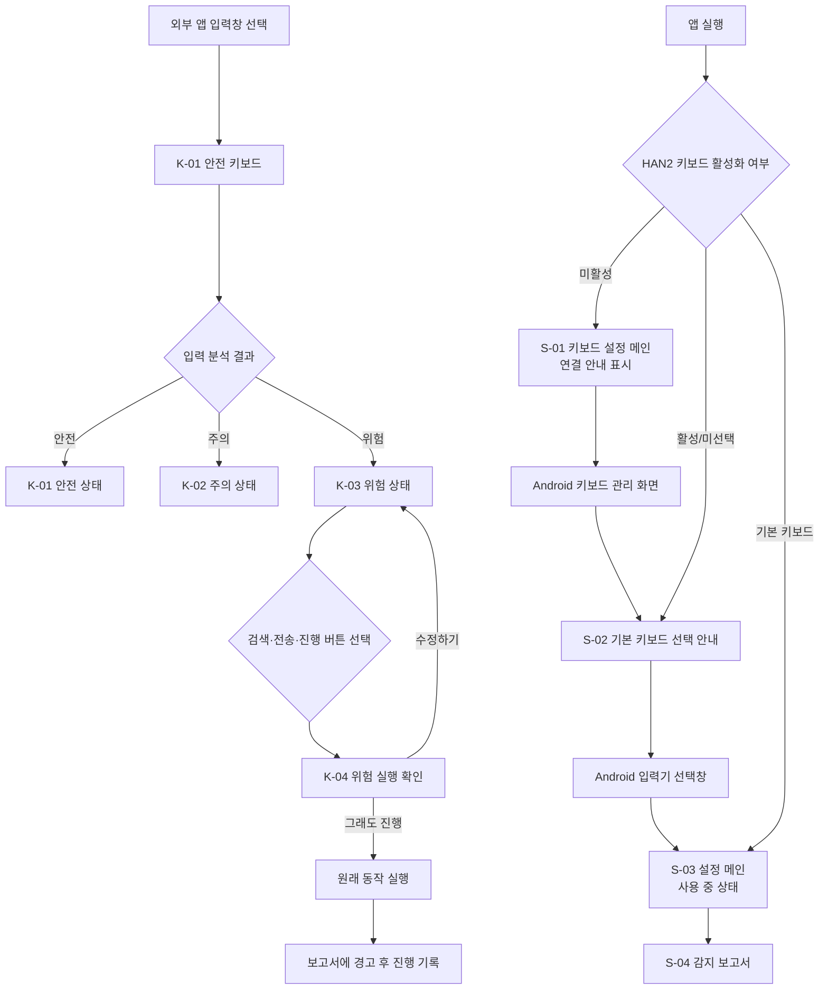

# HAN2 안전 키보드 화면설계도

- 문서 버전: 1.0
- 앱 버전: 0.1.4
- 작성일: 2026-08-11
- 기준 플랫폼: Android 모바일
- 기준 해상도: 360 × 800dp

## 1. 제품 화면 구조



## 2. 화면 목록

| 화면 ID | 화면명 | 진입 조건 | 핵심 목적 |
|---|---|---|---|
| S-01 | 키보드 설정 메인·미연결 | HAN2 미활성 | 키보드 활성화 안내 |
| S-02 | 기본 키보드 선택 안내 | 활성화됐지만 기본 입력기가 아님 | HAN2를 기본 입력기로 선택 |
| S-03 | 키보드 설정 메인·사용 중 | HAN2가 기본 입력기 | 실제 키보드 기능 설정 |
| S-04 | 감지 보고서 | 설정 화면 하단의 `보기` 선택 | 감지 내역과 이유 확인 |
| K-01 | 안전 키보드·안전 | 일반 입력 | 현재 입력이 안전함을 표시 |
| K-02 | 안전 키보드·주의 | 개인정보 또는 금융 위험 가능성 | 재확인 유도 |
| K-03 | 안전 키보드·위험 | 민감정보 또는 고위험 표현 | 실행 전 강한 경고 |
| K-04 | 위험 실행 확인 | 위험 상태에서 실행 버튼 선택 | 실행 보류 후 최종 의사 확인 |
| K-05 | 민감 입력 보호 | 비밀번호·PIN 입력창 | 분석과 기록 중단 안내 |

---

## 3. S-01 키보드 설정 메인·미연결

### 와이어프레임

```text
┌──────────────────────────────────┐
│  ⌨ HAN2 KEYBOARD       설정 필요 │
│                                  │
│  키보드 설정                     │
│  입력에 필요한 기능만 관리하세요 │
│                                  │
│ ┌──────────────────────────────┐ │
│ │ [⌨] HAN2 키보드   [키보드 추가]│ │
│ │      시스템에서 추가해 주세요 │ │
│ └──────────────────────────────┘ │
│                                  │
│ ┌──────────────────────────────┐ │
│ │ 2단계로 키보드를 연결하세요  │ │
│ │ ① HAN2 안전 키보드 켜기      │ │
│ │ ② 기본 키보드로 선택          │ │
│ └──────────────────────────────┘ │
│                                  │
│  미리보기                        │
│ ┌──────────────────────────────┐ │
│ │ 오늘도 안전하게 입력하세요 × │ │
│ │ ● 안전 · 현재 입력은 안전해요│ │
│ │ [키보드 디자인 미리보기]      │ │
│ └──────────────────────────────┘ │
│                                  │
│  핵심 기능 / 키보드 모양 ↓      │
└──────────────────────────────────┘
```

### 구성요소

| 번호 | 요소 | 동작 |
|---|---|---|
| 1 | 상태 배지 `설정 필요` | 현재 Android IME 상태 표시 |
| 2 | `키보드 추가` 버튼 | Android 입력 방법 관리 화면 실행 |
| 3 | 2단계 연결 안내 | 현재 완료 단계 표시 |
| 4 | 테스트 입력창 | 선택 시 실제 Android 키보드 실행 |
| 5 | 키보드 미리보기 | 현재 설정에 따른 외형 확인용 |

### 상태 규칙

- HAN2가 활성화되지 않았으면 1단계를 보라색으로 강조한다.
- Android 설정에서 돌아오면 활성화 상태를 즉시 다시 확인한다.
- 활성화가 완료되면 S-02 상태로 전환한다.

---

## 4. S-02 기본 키보드 선택 안내

```text
┌──────────────────────────────────┐
│  ⌨ HAN2 KEYBOARD       선택 필요 │
│                                  │
│ ┌──────────────────────────────┐ │
│ │ [⌨] HAN2 키보드      [선택하기]│ │
│ │      기본 키보드로 선택해 주세요││
│ └──────────────────────────────┘ │
│                                  │
│ ┌──────────────────────────────┐ │
│ │ 마지막 1단계가 남았어요      │ │
│ │ ① HAN2 안전 키보드 켜기  ✓   │ │
│ │ ② 기본 키보드로 선택      ●   │ │
│ └──────────────────────────────┘ │
└──────────────────────────────────┘
```

- `선택하기`를 누르면 Android 입력기 선택창을 표시한다.
- HAN2 선택 완료 후 앱으로 돌아오면 상태 배지를 `기본 키보드`로 변경한다.
- Android 보안 정책상 앱이 기본 입력기를 임의로 변경하지 않는다.

---

## 5. S-03 키보드 설정 메인·사용 중

### 전체 구조

```text
┌──────────────────────────────────┐
│  ⌨ HAN2 KEYBOARD       ● 기본 키보드│
│  키보드 설정                     │
│  입력에 필요한 기능만 관리하세요 │
│                                  │
│ [HAN2 키보드 / 사용 가능] [변경] │
├──────────────────────────────────┤
│  미리보기                        │
│  테스트 입력 + 안전 상태 + 키배열│
├──────────────────────────────────┤
│  핵심 기능                       │
│  🛡 안전 입력 보호         [ON]  │
│  ✦ 문장 추천               [ON]  │
│  〰 키 입력 진동           [ON]  │
│  🔊 키 입력 소리           [OFF] │
├──────────────────────────────────┤
│  키보드 모양                     │
│  # 숫자 행                 [OFF] │
│  🎨 테마                  시스템 │
├──────────────────────────────────┤
│  ⓘ HAN2 키보드 정보              │
├──────────────────────────────────┤
│  ▤ 감지 보고서              보기 ›│
└──────────────────────────────────┘
```

### 설정 동작표

| 설정 | 기본값 | 실제 키보드 반영 | 저장 위치 |
|---|---:|---|---|
| 안전 입력 보호 | ON | 위험 분석 및 경고 ON/OFF | Android 네이티브 저장소 |
| 문장 추천 | ON | 현재 UI 준비, 추천 엔진 연결 예정 | 로컬 설정 |
| 키 입력 진동 | ON | 모든 키 터치 진동 | Android 네이티브 저장소 |
| 키 입력 소리 | OFF | 모든 키 터치음 | Android 네이티브 저장소 |
| 숫자 행 | OFF | 한글·영문 키보드 상단 숫자 행 | Android 네이티브 저장소 |
| 테마 | 시스템 | 시스템·라이트·다크 | Android 네이티브 저장소 |

---

## 6. K-01 실제 키보드·안전 상태

```text
┌──────────────────────────────────┐
│ ● 안전 · 현재 입력은 안전해요   │
│   위험 요소가 발견되지 않았어요 │
├──────────────────────────────────┤
│ [ㅂ][ㅈ][ㄷ][ㄱ][ㅅ][ㅛ][ㅕ][ㅑ][ㅐ][ㅔ]│
│  [ㅁ][ㄴ][ㅇ][ㄹ][ㅎ][ㅗ][ㅓ][ㅏ][ㅣ] │
│ [ㅋ][ㅌ][ㅊ][ㅍ][ㅠ][ㅜ][ㅡ][⌫]  │
│ [123][한/영][    공백    ][.][검색]│
└──────────────────────────────────┘
```

### 표시 규칙

- 배경: 연한 초록색
- 상태 점: 초록색
- 제목: 현재 입력이 안전함
- 설명: 위험 요소가 발견되지 않았음을 안내
- 입력창 액션에 맞춰 오른쪽 아래 버튼을 자동 변경한다.

---

## 7. K-02 실제 키보드·주의 상태

```text
┌──────────────────────────────────┐
│ ● 주의 · 개인정보로 보이는 번호예요│
│   공유해도 되는 정보인지 확인하세요│
├──────────────────────────────────┤
│             키 배열              │
│                        [전송]    │
└──────────────────────────────────┘
```

### 감지 예시

- 휴대전화 번호 형태
- 계좌, 송금, 입금, 상품권, 대출 관련 문구
- `http://` 주소
- 단축 URL

### 동작

- 상태 영역을 노란색으로 변경한다.
- 사용자가 내용을 재확인하도록 안내한다.
- 현재 단계에서는 주의 상태의 실행을 강제로 보류하지 않는다.
- 주의 감지 내용을 로컬 보고서에 기록한다.

---

## 8. K-03 실제 키보드·위험 상태

```text
┌──────────────────────────────────┐
│ ● 위험 · 민감정보가 포함됐어요  │
│   번호를 삭제하거나 가린 뒤 보내세요│
├──────────────────────────────────┤
│             키 배열              │
│                        [전송]    │
└──────────────────────────────────┘
```

### 감지 예시

- 주민등록번호 형태
- `비밀번호`, `OTP`, `인증번호`와 숫자 조합
- 위협·협박 표현
- 자해 위험 표현

### 동작

- 상태 영역을 빨간색으로 변경한다.
- 실행 버튼 선택 전까지 입력 수정은 계속 허용한다.
- 실행 버튼을 누르면 K-04 확인 상태로 전환한다.

---

## 9. K-04 위험 실행 확인

```text
┌──────────────────────────────────┐
│ 위험으로 판단되어 전송을 중지했습니다│
│ 정말로 이 내용을 진행하시겠습니까? │
├──────────────────────────────────┤
│ [       수정하기       ] [그래도 진행]│
├──────────────────────────────────┤
│             키 배열              │
└──────────────────────────────────┘
```

### 버튼 동작

| 버튼 | 처리 결과 |
|---|---|
| 수정하기 | 실행하지 않고 입력 상태 유지, `전송을 중지했어요` 표시 |
| 그래도 진행 | 원래 검색·전송·진행·완료 동작 실행, 보고서에 `경고 후 진행` 기록 |

### 적용 액션

- 검색
- 진행
- 전송
- 다음
- 이전
- 완료
- 입력

### 시스템 제약

키보드의 Android 입력 액션은 보류할 수 있다. 외부 앱 화면에 별도로 존재하는 전송 버튼을 사용자가 직접 누르는 동작은 키보드에서 강제로 차단할 수 없다.

---

## 10. K-05 민감 입력 보호

```text
┌──────────────────────────────────┐
│ 🔒 보호 · 민감정보 입력 중       │
│    분석과 저장을 중지했어요      │
├──────────────────────────────────┤
│             키 배열              │
└──────────────────────────────────┘
```

- 비밀번호, PIN, 숨김 입력 필드에서 적용한다.
- 문장 분석, 추천, 감지 기록 및 보고서 작성을 중지한다.
- 입력 내용은 후보 영역에 표시하지 않는다.

---

## 11. S-04 감지 보고서

### 와이어프레임

```text
┌──────────────────────────────────┐
│ HAN2 SAFETY REPORT          [×]  │
│ 감지 보고서                      │
│ 원문 전체는 저장하지 않습니다.  │
├──────────────────────────────────┤
│   전체 12   │   위험 4   │ 주의 8│
├──────────────────────────────────┤
│ ┌──────────────────────────────┐ │
│ │ [위험]             8월 11일  │ │
│ │ 경고 후 진행                 │ │
│ │ 인증번호 ••••••를 입력...   │ │
│ │ 감지 이유                    │ │
│ │ 위험 경고 후 사용자가 진행  │ │
│ └──────────────────────────────┘ │
│ ┌──────────────────────────────┐ │
│ │ [주의]             8월 11일  │ │
│ │ 금융사기 주의               │ │
│ │ 계좌로 송금해 주세요        │ │
│ │ 감지 이유: 송금 유도 표현   │ │
│ └──────────────────────────────┘ │
├──────────────────────────────────┤
│ [기록 비우기]              [확인]│
└──────────────────────────────────┘
```

### 데이터 표시 원칙

- 최신 감지를 위에 표시한다.
- 최대 30건만 보관한다.
- 모든 숫자는 `•`로 치환한다.
- 긴 입력은 마지막 80자만 표시한다.
- 동일 감지는 30초 동안 중복 기록하지 않는다.
- 비밀번호 필드는 기록하지 않는다.

### 빈 상태

```text
              ✓
     아직 감지된 위험이 없어요
 주의·위험 감지 시 여기에 표시됩니다.
```

---

## 12. 색상 및 상태 규격

| 상태 | 주요 색상 | 배경 | 의미 |
|---|---|---|---|
| 기본 브랜드 | `#6C67E1` | `#F0EFFF` | 설정, 선택, 활성 |
| 안전 | `#23825B` | `#E8F8F0` | 위험 없음 |
| 주의 | `#AA6715` | `#FFF6E0` | 재확인 필요 |
| 위험 | `#B73237` | `#FFE9EA` | 실행 전 확인 필요 |
| 비활성 | `#646C78` | `#EEF0F4` | 보호 기능 꺼짐 |

## 13. 텍스트 규격

| 용도 | 크기 | 굵기 |
|---|---:|---:|
| 화면 제목 | 30–38px | 800 |
| 카드 제목 | 14–18px | 700 |
| 본문 | 11–14px | 400–500 |
| 보조 설명 | 9–12px | 400–500 |
| 키 라벨 | 18px | 700 |
| 상태 제목 | 12px | 700 |

## 14. 접근성 기준

- 모든 토글은 `role=switch`와 현재 상태를 제공한다.
- 상태는 색상뿐 아니라 `안전`, `주의`, `위험` 텍스트로 구분한다.
- 키 터치 영역은 최소 44dp 이상으로 유지한다.
- 위험 확인 버튼은 문구가 명확하고 서로 충분히 떨어져야 한다.
- 다크 테마에서도 키와 글자 명암비를 유지한다.
- 보고서 닫기, 기록 삭제 버튼에 접근성 이름을 제공한다.

## 15. 현재 구현 범위와 후속 설계

### 구현 완료

- 시스템 IME 등록과 모든 표준 입력창 표시
- 앱 종료 후 독립 키보드 프로세스 동작
- 로컬 규칙 기반 안전 상태
- 위험 실행 보류와 사용자 확인
- 로컬 감지 보고서
- 앱 설정과 실제 키보드 동기화

### 후속 구현 필요

- 쌍자음, 복합모음, 겹받침을 포함한 완전한 한글 조합
- 실제 문장 추천 엔진
- 백엔드 위험 분석 API
- 안전한 대체 문장 제안
- 앱별 보호 수준 설정
- 오탐 신고 및 예외 처리
- 보고서 기간·유형 필터
- 보안 검증과 개인정보 처리방침

## 16. 기본 입력기 유지 정책

- 실제 Android 기기는 사용자가 선택한 HAN2 기본 입력기 상태를 운영체제 설정에 보관한다.
- 앱은 실행·복귀 시 기본 입력기 상태를 확인하고 해제됐으면 `선택 필요`를 표시한다.
- Android 보안 정책상 사용자 승인 없이 앱이 기본 입력기를 강제로 변경하지 않는다.
- 개발용 에뮬레이터는 Quick Boot 스냅샷이 과거 입력기 설정을 복원할 수 있으므로 `run-android-han2.cmd`로 실행한다.
- 개발 실행 파일은 부팅 후 HAN2 활성화, 기본 입력기 지정, 화면 키보드 표시를 자동 복구한다.
